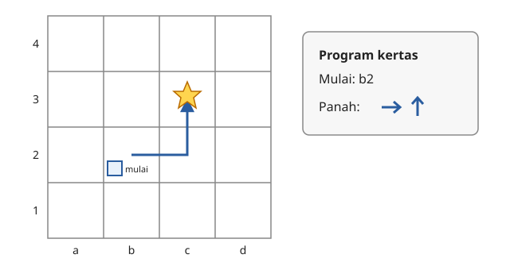

# Program kertas dua langkah

**Ingat dulu:** Tanpa melihat catatan, tulis jalur dua panah. Di mana berakhirnya?

**Contoh:** Program kertas: Mulai b2. Panah: → ↑.

`[Gambar: kisi 4x4. Panah dari b2 ke kanan sampai c2, lalu ke atas sampai c3, tempat bintang. Di samping ada kertas program: "Mulai b2" dan dua panah.]`

Berakhir di c3.

**Bandingkan:**

| | Program A | Program B |
| --- | --- | --- |
| Mulai | b2 | b2 |
| Panah | → ↑ | → → |
| Berakhir di | c3 | ______ |

Apa yang sama? ______

Apa yang beda? ______

**Coba:** Mulai a1. Bintang b2.

Mulai a1. Panah: → ______

Sekarang sendiri. Mulai b3. Bintang a4. Tulis programmu.

Mulai b3. Panah: ______

Tukar dengan temanmu. Berakhir di a4? ______

**Ceritakan** ke temanmu: apa tugas penulis program?

**Catatan cetak (untuk guru, tidak dicetak):** satu lembar per murid, kertas A4. Lembar tidak memuat kolom nama, kelompok, tanggal, atau nilai; penandaan kertas diurus guru di sekolah.
