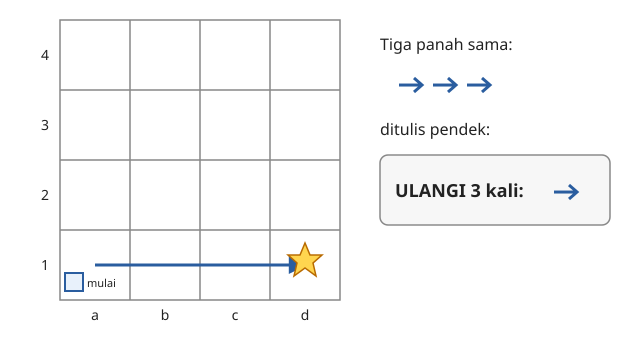

# Pengulangan "ulangi n kali"

**Ingat dulu:** Tanpa melihat catatan, tulis satu program dua panah.

**Contoh:** → → → bisa ditulis pendek: ULANGI 3 kali: →

`[Gambar: kisi 4x4. Tiga panah kanan dari a1 sampai d1. Di samping ada kotak: "ULANGI 3 kali: →".]`

Dari a1, berakhir di d1.

**Bandingkan:**

| | Jalur A | Jalur B |
| --- | --- | --- |
| Tulisan | → → → ↑ ↑ | ULANGI 3 kali: →, lalu ULANGI 2 kali: ↑ |
| Dari a1 berakhir di | d3 | ______ |

Apa yang sama? ______

Apa yang beda? ______

**Coba:** Mulai a1. Jalur: ↑ ↑ ↑ → →

ULANGI ____ kali: ↑

ULANGI 2 kali: →

Sekarang sendiri. Pendekkan jalur ini dari a1:

→ ↑ → ↑ → ↑

______

Tukar dengan temanmu. Berakhir di d4? ______

**Ceritakan** ke temanmu: mengapa jalur pendek dan panjang sama hasilnya?

**Catatan cetak (untuk guru, tidak dicetak):** satu lembar per murid, kertas A4. Lembar tidak memuat kolom nama, kelompok, tanggal, atau nilai; penandaan kertas diurus guru di sekolah.
