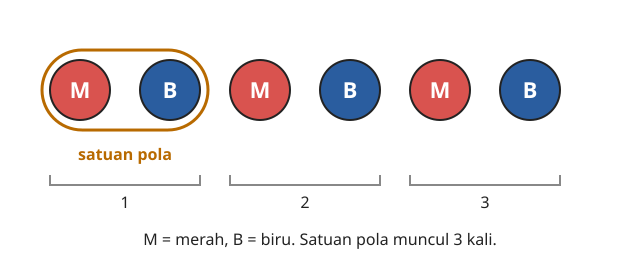

# Pola berulang

**Ingat dulu:** Tanpa melihat catatan, gambar tiga bentuk yang berpola.

**Contoh:** Manik: merah, biru, merah, biru, merah, biru. Satuan pola: merah biru.

`[Gambar: enam lingkaran berderet, berselang merah dan biru. Tiap lingkaran bertanda huruf M atau B. Dua lingkaran pertama dilingkari sebagai satuan pola.]`

Satuan pola muncul tiga kali.

**Bandingkan:**

| | Pola A | Pola B |
| --- | --- | --- |
| Manik | merah biru merah biru merah biru | merah merah biru merah merah biru |
| Satuan | merah biru | ______ |

Apa yang sama? ______

Apa yang beda? ______

**Coba:** bulat bulat kotak bulat bulat kotak bulat ______ ______

Sekarang sendiri. Lingkari satuan pola:

kuning hijau hijau kuning hijau hijau kuning hijau hijau

Satuannya: ______

Buat polamu sendiri. Minta temanmu menebak satuannya.

**Ceritakan** ke temanmu: bagaimana kamu menemukan satuan pola?

**Catatan cetak (untuk guru, tidak dicetak):** satu lembar per murid, kertas A4. Lembar tidak memuat kolom nama, kelompok, tanggal, atau nilai; penandaan kertas diurus guru di sekolah.
