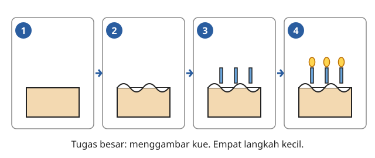

# Memecah tugas besar

**Ingat dulu:** Tanpa melihat catatan, sebut satu langkah mencuci tangan.

**Contoh:** Tugas besar: menggambar kue. Pecah jadi langkah kecil.

`[Gambar: empat kotak berderet, bernomor 1 sampai 4. Kotak 1: kotak besar. Kotak 2: garis krim di atasnya. Kotak 3: tiga lilin. Kotak 4: api kecil di tiap lilin.]`

**Bandingkan:**

| | Cara A | Cara B |
| --- | --- | --- |
| Langkah | empat langkah kecil | satu langkah: "gambar kue yang bagus" |
| Mudah dijalankan? | ______ | ______ |

Apa yang sama? ______

Apa yang beda? ______

**Coba:** Menggambar rumah. Beri nomor 1 sampai 4.

( ) pintu

( ) atap segitiga

( ) dinding kotak

( ) jendela

Sekarang sendiri. Tugas besar: menggambar bunga. Tulis atau gambar tiga langkah kecil.

1. ______
2. ______
3. ______

Tukar dengan temanmu. Bisa ia ikuti? ______

**Ceritakan** ke temanmu: mengapa langkah kecil lebih mudah?

**Catatan cetak (untuk guru, tidak dicetak):** satu lembar per murid, kertas A4. Lembar tidak memuat kolom nama, kelompok, tanggal, atau nilai; penandaan kertas diurus guru di sekolah.
