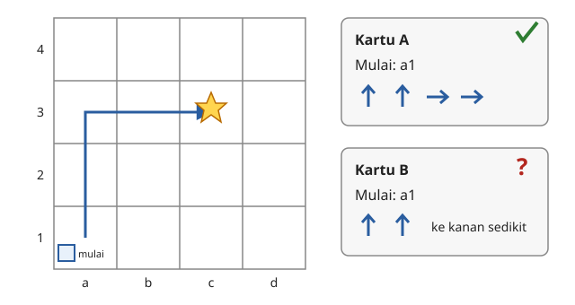

# Menguji instruksi teman

**Ingat dulu:** Tanpa melihat catatan, sebut satu cara memecah tugas besar.

**Contoh:** Kartu instruksi: Mulai a1. ↑ ↑ → →. Penguji menjalankannya.

`[Gambar: kisi 4x4 dengan jalur panah dari a1 ke a3, lalu ke c3, tempat bintang. Di samping ada kartu "Mulai a1" dengan empat panah dan tanda centang.]`

Catatan uji: jelas. Berakhir di c3.

**Bandingkan:**

| | Kartu A | Kartu B |
| --- | --- | --- |
| Isi | Mulai a1. ↑ ↑ → → | Mulai a1. ↑ ↑ ke kanan sedikit |
| Bisa dijalankan? | ya | ______ |

Apa yang sama? ______

Apa yang beda? ______

**Coba:** Kartu: ↑ → →

Apa yang kurang jelas? ______

Sekarang sendiri. Tulis kartu: tempat mulai dan tiga panah.

______

Tukar dengan temanmu. Ia menulis: jelas atau kurang jelas? ______

**Ceritakan** ke temanmu: mengapa penguji menjalankan yang tertulis saja?

**Catatan cetak (untuk guru, tidak dicetak):** satu lembar per murid, kertas A4. Lembar tidak memuat kolom nama, kelompok, tanggal, atau nilai; penandaan kertas diurus guru di sekolah.
