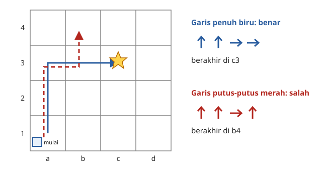

**Ingat dulu:** Tanpa melihat catatan, sebut satu hal yang membuat instruksi kurang jelas.

**Contoh:** Bintang di c3. Mulai a1. Instruksi salah: ↑ ↑ → ↑

`[Gambar: kisi 4x4. Jalur putus-putus dari a1 ke a3, ke b3, lalu ke atas sampai b4. Jalur garis penuh dari a1 ke a3, lalu ke kanan sampai c3, tempat bintang.]`

Panah keempat salah. Ganti jadi →. Sekarang berakhir di c3.

**Bandingkan:**

| | Salah | Diperbaiki |
| --- | --- | --- |
| Panah | ↑ ↑ → ↑ | ↑ ↑ → → |
| Berakhir di | b4 | ______ |

Apa yang sama? ______

Apa yang beda? ______

**Coba:** Mulai b1. Bintang di d2. Instruksi salah: → → ↑ ↑

Buang satu panah. Instruksi baru: ______

Sekarang sendiri. Mulai a1. Bintang di d4. Instruksi salah: ↑ ↑ ↑ → → ←

Panah yang salah: ______

Instruksi baru: ______

**Ceritakan** ke temanmu: bagaimana kamu menemukan panah yang salah?

**Catatan cetak (untuk guru, tidak dicetak):** satu lembar per murid, kertas A4. Lembar tidak memuat kolom nama, kelompok, tanggal, atau nilai; penandaan kertas diurus guru di sekolah.
