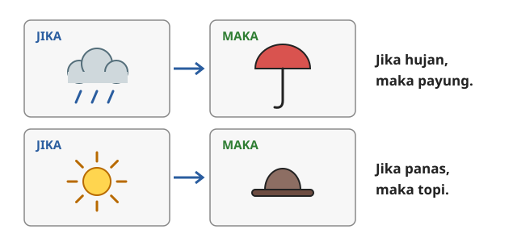

**Ingat dulu:** Tanpa melihat catatan, gambar satu panah dan tulis artinya.

**Contoh:** Jika hujan, maka payung.

`[Gambar: dua baris kartu. Baris pertama: kartu JIKA bergambar awan dan tetes hujan, panah, kartu MAKA bergambar payung. Baris kedua: kartu JIKA bergambar matahari, panah, kartu MAKA bergambar topi.]`

**Bandingkan:**

| | Kartu A | Kartu B |
| --- | --- | --- |
| Jika | hujan | panas |
| Maka | payung | ______ |

Apa yang sama? ______

Apa yang beda? ______

**Coba:** Jika malam, maka ______. (lampu atau topi?)

Sekarang sendiri.

Jika lapar, maka ______.

Gambar satu kartu "jika" dan satu kartu "maka". Tukar dengan temanmu. Cocok? ______

**Ceritakan** ke temanmu: mengapa kartu "maka" bergantung pada kartu "jika"?

**Catatan cetak (untuk guru, tidak dicetak):** satu lembar per murid, kertas A4. Lembar tidak memuat kolom nama, kelompok, tanggal, atau nilai; penandaan kertas diurus guru di sekolah.
