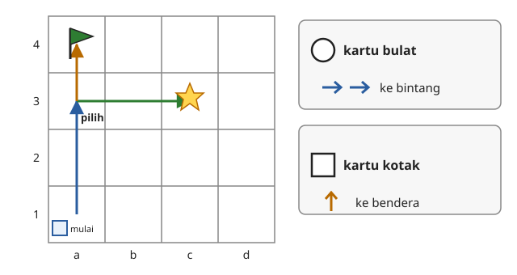

**Ingat dulu:** Tanpa melihat catatan, tulis satu kalimat "jika ... maka ...".

**Contoh:** Mulai a1. ↑ ↑ sampai a3, lalu pilih kartu. Jika kartu bulat, maka → →. Jika kartu kotak, maka ↑.

`[Gambar: kisi 4x4. Dari a1 jalur naik ke a3. Dari a3 ada dua jalan: dua panah kanan ke c3, tempat bintang, dan satu panah atas ke a4, tempat bendera. Di samping ada kartu bulat dan kartu kotak.]`

Kartu bulat berakhir di c3.

**Bandingkan:**

| | Kartu bulat | Kartu kotak |
| --- | --- | --- |
| Jalur dari a1 | ↑ ↑ → → | ↑ ↑ ↑ |
| Berakhir di | c3 | ______ |

Apa yang sama? ______

Apa yang beda? ______

**Coba:** Kartu kotak. ↑ ↑ ____ . Berakhir di ____.

Sekarang sendiri. Kartu bulat. Tulis jalur dari a1 sampai bintang:

______

Tukar dengan temanmu. Ia menjalankannya. Sampai di bintang? ______

**Ceritakan** ke temanmu: mengapa satu kartu hanya memilih satu jalan?

**Catatan cetak (untuk guru, tidak dicetak):** satu lembar per murid, kertas A4. Lembar tidak memuat kolom nama, kelompok, tanggal, atau nilai; penandaan kertas diurus guru di sekolah.
