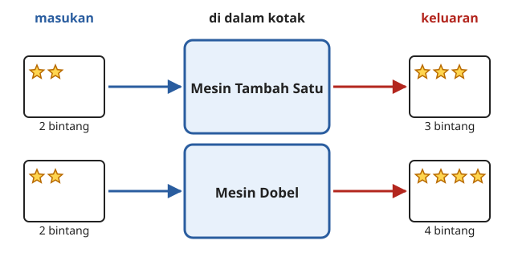

**Ingat dulu:** Tanpa melihat catatan, apa arti satu warna pada kode warna?

**Contoh:** Mesin Tambah Satu. Masuk 2 bintang. Keluar 3 bintang.

`[Gambar: dua baris. Baris pertama: kartu 2 bintang masuk kotak "Mesin Tambah Satu", keluar kartu 3 bintang. Baris kedua: kartu 2 bintang masuk kotak "Mesin Dobel", keluar kartu 4 bintang. Tulisan di atas: masukan, di dalam kotak, keluaran.]`

**Bandingkan:**

| | Tambah Satu | Dobel |
| --- | --- | --- |
| Masuk | 2 bintang | 2 bintang |
| Keluar | 3 bintang | ______ bintang |

Apa yang sama? ______

Apa yang beda? ______

**Coba:** Mesin Tambah Satu. Masuk 4 bintang. Keluar ______ bintang.

Sekarang sendiri. Mesin rahasia.

| Masuk | Keluar |
| --- | --- |
| 1 | 3 |
| 2 | 4 |
| 5 | ______ |

Aturan mesin rahasia: ______

**Ceritakan** ke temanmu: apa masukan, apa keluaran, dan apa yang ada di dalam kotak?

**Catatan cetak (untuk guru, tidak dicetak):** satu lembar per murid, kertas A4. Lembar tidak memuat kolom nama, kelompok, tanggal, atau nilai; penandaan kertas diurus guru di sekolah.
