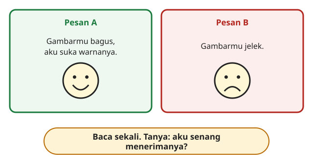

**Ingat dulu:** Tanpa melihat catatan, apa yang kamu lakukan agar temanmu merasa baik?

**Contoh:** Beni membalas Lila: "Gambarmu bagus, aku suka warnanya." Lila **senang**.

`[Gambar: dua kotak pesan. Kiri, "Gambarmu bagus, aku suka warnanya." dengan wajah senang berupa garis sederhana. Kanan, "Gambarmu jelek." dengan wajah sedih berupa garis sederhana. Di bawah: "Baca sekali. Tanya: aku senang menerimanya?"]`

**Bandingkan:**

| | Pesan A: "Gambarmu bagus" | Pesan B: "Gambarmu jelek" |
| --- | --- | --- |
| Lila merasa | senang | ______ |

Apa yang sama? ______

Apa yang beda? ______

**Coba:** Pesan: "Kamu tidak boleh ikut main!" Ganti dengan kata yang baik: ______

Sekarang sendiri. Lingkari pesan yang baik.

1. "Terima kasih sudah membantu."
2. "Kamu payah."

Bila ada pesan yang menyakitkan, aku tidak membalas dan aku ______

**Ceritakan** ke temanmu: kata baik apa yang kamu pilih, dan mengapa?

**Catatan cetak (untuk guru, tidak dicetak):** satu lembar per murid, kertas A4. Lembar tidak memuat kolom nama, kelompok, tanggal, atau nilai; penandaan kertas diurus guru di sekolah.
