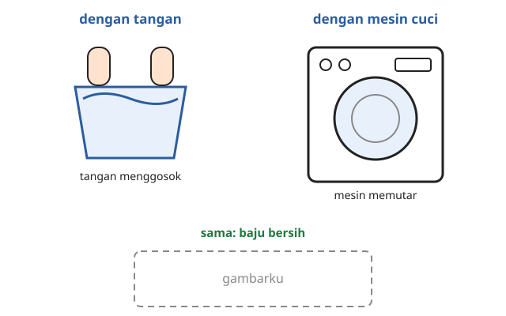

**Ingat dulu:** Tanpa melihat catatan, apa tiga bagian mesin kotak?

**Contoh:** Mesin cuci membantu keluarga mencuci baju. Ibu yang menekan tombolnya.

`[Gambar: dua kotak. Kiri, dua tangan dan ember berisi baju. Kanan, mesin cuci persegi dengan lingkaran di tengah dan tombol di atas. Di bawah, kotak kosong bertanda "gambarku" untuk menggambar satu alat.]`

**Bandingkan:**

| | Dengan tangan | Dengan mesin cuci |
| --- | --- | --- |
| Hasil | baju bersih | ______ |
| Yang memutar | tangan | ______ |

Apa yang sama? ______

Apa yang beda? ______

**Coba:** Pompa air membantu mengalirkan ______.

Sekarang sendiri. Gambar satu alat di kotak kosong pada gambar.

Kalimatku: ______ membantu ______ ______.

Yang mengaturnya: ______

**Ceritakan** ke temanmu: alat ini membantu mengerjakan apa?

**Catatan cetak (untuk guru, tidak dicetak):** satu lembar per murid, kertas A4. Lembar tidak memuat kolom nama, kelompok, tanggal, atau nilai; penandaan kertas diurus guru di sekolah.
