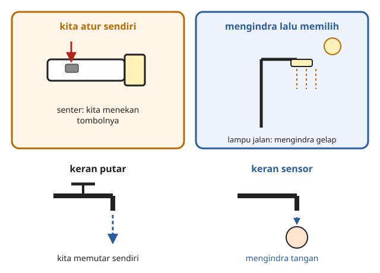

# Penguatan: sortir cerdas dan biasa

**Ingat dulu:** Tanpa melihat catatan, apa yang diindra robot penyapu, dan apa yang ia pilih?

**Contoh:** Lampu jalan mengindra gelap, lalu memilih menyala. Senter: kita yang menekan tombolnya.

`[Gambar: dua kotak. Kiri, "kita atur sendiri": senter dengan tombol dan tangan yang menekan. Kanan, "mengindra lalu memilih": lampu jalan dengan bulan di atasnya dan garis cahaya ke bawah. Di bawah, dua keran berdampingan: keran putar dengan pegangan, dan keran sensor dengan tangan di bawahnya.]`

**Bandingkan:**

| | Keran putar | Keran sensor |
| --- | --- | --- |
| Kita putar sendiri? | ya | ______ |
| Mengindra tangan lalu memilih? | tidak | ______ |

Apa yang sama? ______

Apa yang beda? ______

**Coba:** Mobil mainan dengan kendali jauh. Siapa yang menekan tombolnya? ______

Kotak mana? kita atur sendiri / mengindra lalu memilih

Sekarang sendiri.

1. Keran sensor mengindra ______ dan memilih ______ ______.
2. Senter. Kotak mana? kita atur sendiri / mengindra lalu memilih

**Ceritakan** ke temanmu: bagaimana kamu tahu alat itu mengindra lalu memilih?

**Catatan cetak (untuk guru, tidak dicetak):** satu lembar per murid, kertas A4. Lembar tidak memuat kolom nama, kelompok, tanggal, atau nilai; penandaan kertas diurus guru di sekolah.
