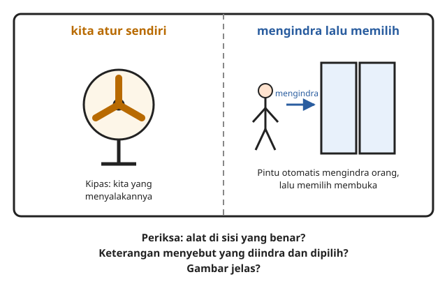

**Ingat dulu:** Tanpa melihat catatan, apa yang diindra lampu jalan, dan apa yang ia pilih?

**Contoh:** Kipas: kita yang menyalakannya. Pintu otomatis: mengindra orang, lalu memilih membuka.

`[Gambar: poster dua sisi. Kiri, "kita atur sendiri": kipas dan keterangan "Kipas: kita yang menyalakannya". Kanan, "mengindra lalu memilih": pintu otomatis dengan panah dari orang ke pintu dan keterangan "Pintu otomatis mengindra orang, lalu memilih membuka". Di bawah, daftar periksa tiga hal.]`

**Bandingkan:**

| | Keterangan A | Keterangan B |
| --- | --- | --- |
| Tulisan | "Pintu otomatis itu cerdas." | "Pintu otomatis mengindra orang, lalu memilih membuka." |
| Menyebut yang diindra? | tidak | ______ |

Apa yang sama? ______

Apa yang beda? ______

**Coba:** Lampu jalan mengindra ______, lalu memilih ______.

Sekarang sendiri. Tulis keterangan untuk satu alat di posternya.

Alat: ______ Sisi: ______

Keterangan: ______

**Periksa bersama kelompok:** alat di sisi yang benar? keterangan menyebut yang diindra dan dipilih? gambar jelas?

**Ceritakan** ke temanmu: apa yang kelompokmu perbaiki?

**Catatan cetak (untuk guru, tidak dicetak):** satu lembar per murid, kertas A4. Lembar tidak memuat kolom nama, kelompok, tanggal, atau nilai; penandaan kertas diurus guru di sekolah.
