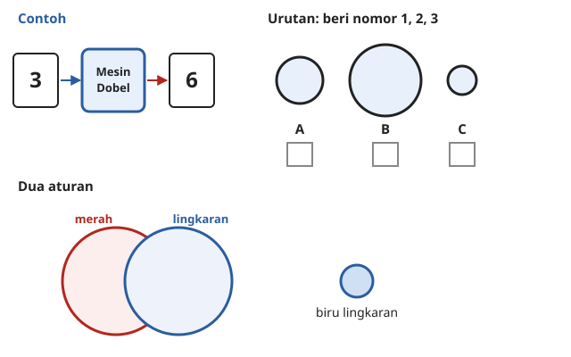

**Ingat dulu:** Tanpa melihat catatan, tulis satu hal dari semester ini yang sudah kamu bisa.

**Contoh:** Mesin Dobel. Masukan 3. Keluaran 6.

`[Gambar: tiga bagian. Kiri, kartu 3 masuk kotak "Mesin Dobel" dan keluar kartu 6. Tengah, tiga lingkaran berbeda ukuran dengan huruf A, B, C dan kotak kosong di bawahnya. Kanan, dua lingkaran sortir bertumpang bertanda "merah" dan "lingkaran" dengan kartu biru lingkaran di bawahnya.]`

**Bandingkan:**

| | Papan ketik | Layar |
| --- | --- | --- |
| Siapa yang memberi? | kita | ______ |
| Masukan atau keluaran? | masukan | ______ |

Apa yang beda? ______

**Coba:** Pakai gambar.

1. Mesin Tambah Satu. Masukan 4. Keluaran ______.
2. Mata dan kamera sama-sama menerima ______.
3. Boleh dibagikan? Warna kesukaan Lila: ______. Kata sandi Lila: ______.
4. Beri nomor 1, 2, 3 pada lingkaran A, B, C dari yang terkecil.
5. Pintu otomatis mengindra orang lalu memilih membuka. Kotak mana? kita atur sendiri / mengindra lalu memilih
6. Lingkari pesan yang baik: "Terima kasih sudah membantu." atau "Kamu payah."
7. Kartu biru lingkaran masuk: kiri, tengah, kanan, atau luar? ______

**Ceritakan** ke temanmu: satu hal yang sudah bisa, satu hal yang masih ingin dilatih, dan satu cara melatihnya.

**Catatan cetak (untuk guru, tidak dicetak):** satu lembar per murid, kertas A4. Lembar tidak memuat kolom nama, kelompok, tanggal, atau nilai; penandaan kertas diurus guru di sekolah.
