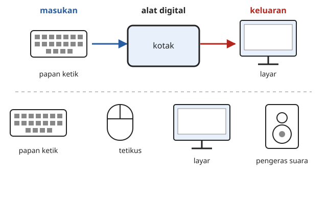

**Ingat dulu:** Tanpa melihat catatan, sebut tiga bagian mesin kotak.

**Contoh:** Papan ketik: kita memberi. Papan ketik adalah **masukan** (M). Layar: kita melihat hasilnya. Layar adalah **keluaran** (K).

`[Gambar: atas, papan ketik dengan panah biru ke kotak alat digital, lalu panah merah ke layar. Bawah: empat gambar bernama papan ketik, tetikus, layar, dan pengeras suara.]`

**Bandingkan:**

| | Papan ketik | Layar |
| --- | --- | --- |
| Siapa yang memberi? | kita | ______ |
| M atau K? | M | ______ |

Apa yang sama? ______

Apa yang beda? ______

**Coba:** Pengeras suara memberi bunyi. M atau K? ______

Sekarang sendiri. Tulis M atau K.

| Perangkat | M atau K |
| --- | --- |
| tetikus | ______ |
| layar | ______ |

**Ceritakan** ke temanmu: bagaimana kamu tahu perangkat itu masukan atau keluaran?

**Catatan cetak (untuk guru, tidak dicetak):** satu lembar per murid, kertas A4. Lembar tidak memuat kolom nama, kelompok, tanggal, atau nilai; penandaan kertas diurus guru di sekolah.
