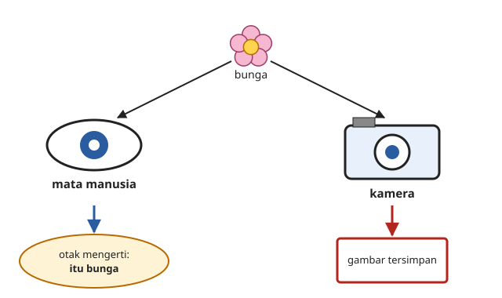

**Ingat dulu:** Tanpa melihat catatan, papan ketik itu masukan atau keluaran?

**Contoh:** Mata dan kamera menerima cahaya dari bunga. Mata punya otak yang mengerti: "itu bunga". Kamera menyimpan gambar.

`[Gambar: bunga di atas. Dua panah dari bunga: ke mata manusia di kiri dan ke kamera di kanan. Dari mata, panah ke awan "otak mengerti: itu bunga". Dari kamera, panah ke bingkai "gambar tersimpan".]`

**Bandingkan:**

| | Mata | Kamera |
| --- | --- | --- |
| Menerima cahaya | ya | ______ |
| Mengerti "itu bunga" | ya, dengan otak | ______ |

Apa yang sama? ______

Apa yang beda? ______

**Coba:** "Menyimpan gambar bunga di alat." Siapa? mata / kamera / keduanya: ______

Sekarang sendiri. Lingkari siapa.

| Pernyataan | Siapa |
| --- | --- |
| tahu bahwa itu bunga | mata dan otak / kamera |
| merasa bunga itu cantik | manusia / kamera |

**Ceritakan** ke temanmu: apa beda mata dan kamera?

**Catatan cetak (untuk guru, tidak dicetak):** satu lembar per murid, kertas A4. Lembar tidak memuat kolom nama, kelompok, tanggal, atau nilai; penandaan kertas diurus guru di sekolah.
