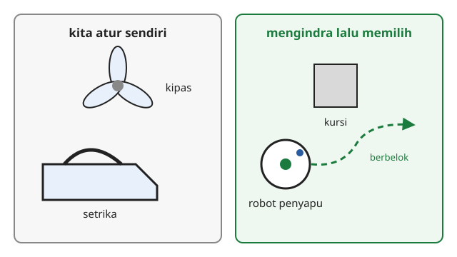

# Mesin cerdas atau biasa

**Ingat dulu:** Tanpa melihat catatan, apa yang sama dari mata dan kamera?

**Contoh:** Kipas: kita atur sendiri. Robot penyapu: ia mengindra kursi, lalu memilih berbelok.

`[Gambar: dua kotak. Kiri, "kita atur sendiri": setrika dan kipas. Kanan, "mengindra lalu memilih": robot penyapu bundar yang berbelok lewat panah putus-putus menjauhi kursi persegi.]`

**Bandingkan:**

| | Kipas | Robot penyapu |
| --- | --- | --- |
| Kita atur sendiri? | ya | ______ |
| Mengindra lalu memilih? | tidak | ______ |

Apa yang sama? ______

Apa yang beda? ______

**Coba:** Pintu otomatis membuka bila ada orang. Kotak mana? ______

Sekarang sendiri. Lampu meja menyala bila kita menekan saklar.

Kotak mana? kita atur sendiri / mengindra lalu memilih

**Ceritakan** ke temanmu: apa yang diindra robot penyapu, dan apa yang ia pilih?

**Catatan cetak (untuk guru, tidak dicetak):** satu lembar per murid, kertas A4. Lembar tidak memuat kolom nama, kelompok, tanggal, atau nilai; penandaan kertas diurus guru di sekolah.
