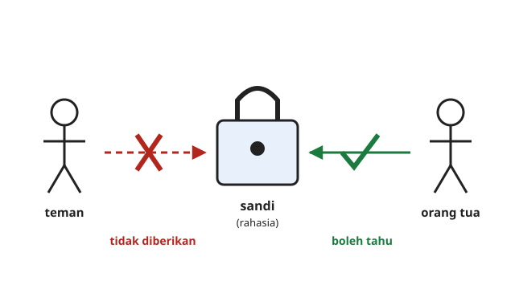

# Kata sandi itu rahasia

**Ingat dulu:** Tanpa melihat catatan, apa yang tidak kita berikan kepada orang asing?

**Contoh:** Lila punya buku bergembok. Sandinya rahasia. Hanya Lila dan orang tuanya yang boleh tahu.

`[Gambar: di tengah gembok bertanda "sandi (rahasia)". Di kiri seorang teman, panah merah putus-putus dengan tanda silang: "tidak diberikan". Di kanan seorang orang tua, panah hijau dengan tanda centang: "boleh tahu".]`

**Bandingkan:**

| | Akhir A | Akhir B |
| --- | --- | --- |
| Lila memberi sandi kepada Beni | ya | tidak |
| Buku Lila aman? | tidak | ______ |

Apa yang sama? ______

Apa yang beda? ______

**Coba:** Orang tua Lila minta sandi Lila. Boleh? ya / tidak

Sekarang sendiri. Beni terus minta sandi Lila.

Lila bilang: ______

Lalu Lila cerita kepada: ______

**Ceritakan** ke temanmu: siapa yang boleh tahu sandi, dan apa yang kamu lakukan bila ada yang memintanya?

**Catatan cetak (untuk guru, tidak dicetak):** satu lembar per murid, kertas A4. Lembar tidak memuat kolom nama, kelompok, tanggal, atau nilai; penandaan kertas diurus guru di sekolah. Murid tidak menulis kata sandi sungguhan.
