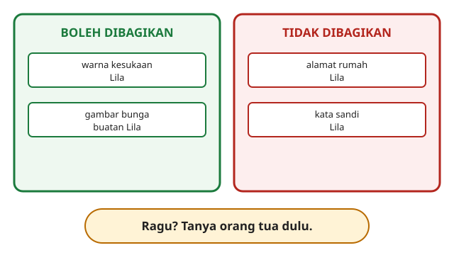

**Ingat dulu:** Tanpa melihat catatan, siapa yang boleh tahu sandi?

**Contoh:** Kartu "warna kesukaan Lila" masuk kotak **boleh**. Kartu "alamat rumah Lila" masuk kotak **tidak**.

`[Gambar: dua kotak. Kiri, hijau, "BOLEH DIBAGIKAN": kartu warna kesukaan Lila dan gambar bunga buatan Lila. Kanan, merah, "TIDAK DIBAGIKAN": kartu alamat rumah Lila dan kata sandi Lila. Di bawah: "Ragu? Tanya orang tua dulu."]`

**Bandingkan:**

| | Kartu warna kesukaan | Kartu alamat rumah |
| --- | --- | --- |
| Boleh dibagikan? | ya | ______ |

Apa yang sama? ______

Apa yang beda? ______

**Coba:** Kartu "nomor telepon ibu Lila". Boleh / tidak: ______

Sekarang sendiri. Tulis boleh atau tidak.

| Kartu | Boleh atau tidak |
| --- | --- |
| makanan kesukaan Lila | ______ |
| foto wajah Lila | ______ |
| nama lengkap Lila | ______ |

Ragu? Aku ______

**Ceritakan** ke temanmu: apa yang kamu lakukan bila ragu?

**Catatan cetak (untuk guru, tidak dicetak):** satu lembar per murid, kertas A4. Lembar tidak memuat kolom nama, kelompok, tanggal, atau nilai; penandaan kertas diurus guru di sekolah. Murid tidak menulis informasi miliknya sendiri.
