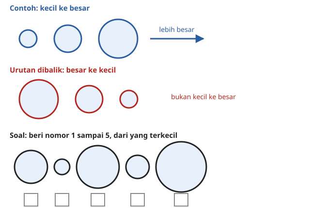

# Mengurutkan menurut ukuran

**Ingat dulu:** Tanpa melihat catatan, sebut satu informasi yang tidak dibagikan.

**Contoh:** Cari yang paling kecil. Taruh di kiri. Ulangi. Hasilnya: kecil, sedang, besar.

`[Gambar: baris pertama, tiga lingkaran dari kecil ke besar dengan panah "lebih besar". Baris kedua, tiga lingkaran dari besar ke kecil, bertanda "bukan kecil ke besar". Baris ketiga, lima lingkaran acak dengan kotak kosong di bawah tiap lingkaran.]`

**Bandingkan:**

| | Urutan A | Urutan B |
| --- | --- | --- |
| Dimulai dari | yang kecil | ______ |
| Dari kecil ke besar? | ya | ______ |

Apa yang sama? ______

Apa yang beda? ______

**Coba:** Kartu A kecil. Kartu B besar. Kartu C sedang.

Urutan dari kecil: A, ______, ______

Sekarang sendiri. Pada gambar, beri nomor 1 sampai 5 dari yang terkecil.

Periksa: lingkaran nomor 2 lebih besar dari nomor 1. Benar? ______

**Ceritakan** ke temanmu: bagaimana kamu mengurutkan dan memeriksa?

**Catatan cetak (untuk guru, tidak dicetak):** satu lembar per murid, kertas A4. Lembar tidak memuat kolom nama, kelompok, tanggal, atau nilai; penandaan kertas diurus guru di sekolah.
