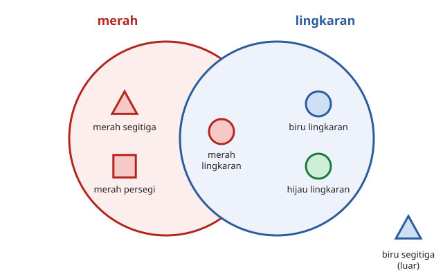

# Mengelompokkan dengan dua aturan

**Ingat dulu:** Tanpa melihat catatan, kartu apa masuk bagian tengah dua lingkaran?

**Contoh:** Lingkaran kiri: merah. Lingkaran kanan: lingkaran. Kartu biru lingkaran: bukan merah, tetapi lingkaran. Masuk **kanan**.

`[Gambar: dua lingkaran bertumpang. Kiri bertanda "merah", kanan bertanda "lingkaran". Bagian tengah berisi merah lingkaran, kiri saja berisi merah segitiga dan merah persegi, kanan saja berisi biru lingkaran dan hijau lingkaran, luar berisi biru segitiga.]`

**Bandingkan:**

| | Merah lingkaran | Merah segitiga |
| --- | --- | --- |
| Merah? | ya | ya |
| Lingkaran? | ya | tidak |
| Bagian | tengah | ______ |

Apa yang sama? ______

Apa yang beda? ______

**Coba:** Kartu biru segitiga. Merah? tidak. Lingkaran? tidak. Bagian: ______

Sekarang sendiri. Tulis kiri, tengah, kanan, atau luar.

| Kartu | Bagian |
| --- | --- |
| hijau lingkaran | ______ |
| merah persegi | ______ |

**Ceritakan** ke temanmu: mengapa merah lingkaran masuk bagian tengah?

**Catatan cetak (untuk guru, tidak dicetak):** satu lembar per murid, kertas A4. Lembar tidak memuat kolom nama, kelompok, tanggal, atau nilai; penandaan kertas diurus guru di sekolah.
