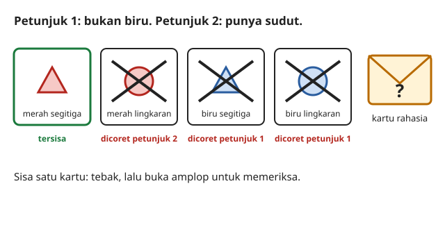

# Menebak kartu rahasia

**Ingat dulu:** Tanpa melihat catatan, bagaimana kamu menebak kartu rahasia?

**Contoh:** Empat kartu. Petunjuk 1: bukan biru. Sisa: merah segitiga dan merah lingkaran. Petunjuk 2: punya sudut. Kartu rahasia: **merah segitiga**.

`[Gambar: empat kartu: merah segitiga, merah lingkaran, biru segitiga, biru lingkaran. Dua kartu biru dicoret oleh petunjuk "bukan biru". Merah lingkaran dicoret oleh petunjuk "punya sudut". Di kanan ada amplop bertanda tanya.]`

**Bandingkan:**

| | Petunjuk 1 saja | Petunjuk 1 dan 2 |
| --- | --- | --- |
| Kartu tersisa | 2 | ______ |

Apa yang sama? ______

Apa yang beda? ______

**Coba:** Kartu: biru lingkaran, biru persegi, merah lingkaran, merah persegi.

Petunjuk: bukan merah. Tidak punya sudut.

Kartu rahasia: ______

Sekarang sendiri. Kartu: hijau segitiga, hijau lingkaran, kuning segitiga, kuning lingkaran.

Petunjuk: bukan hijau. Tidak punya sudut.

Kartu rahasia: ______

**Ceritakan** ke temanmu: bagaimana kamu menebak, dan bagaimana kamu memeriksanya?

**Catatan cetak (untuk guru, tidak dicetak):** satu lembar per murid, kertas A4. Lembar tidak memuat kolom nama, kelompok, tanggal, atau nilai; penandaan kertas diurus guru di sekolah.
