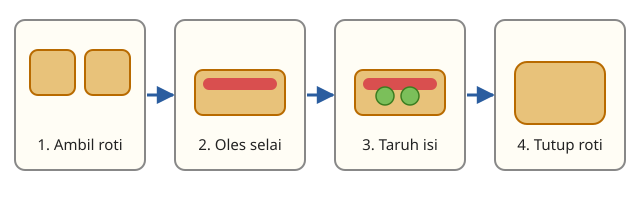

**Ingat dulu:** Tanpa melihat catatan, tulis satu tugas besar dan satu langkah kecilnya.

**Contoh:** Algoritma adalah langkah-langkah yang jelas dan berurutan. Ini algoritma roti isi.

`[Gambar: empat kartu berurutan dengan panah. Kartu 1: dua lembar roti. Kartu 2: selai dioles pada satu lembar. Kartu 3: irisan isi di atas selai. Kartu 4: lembar kedua menutup roti.]`

**Bandingkan:**

| A. Resep roti isi | B. Rute ke tempat cuci tangan |
| --- | --- |
| 1. Ambil dua roti | 1. Keluar pintu |
| 2. Oles selai | 2. Belok kanan |
| 3. Taruh isi | 3. Jalan sepuluh langkah |
| 4. Tutup roti | 4. Berhenti di depan keran |

Apa yang sama? ______

Apa yang beda? ______

Nama untuk keduanya: ______ (petunjuk: dimulai huruf a, sembilan huruf)

**Coba:** Menyikat gigi. Isi dua langkah yang kosong.

1. Ambil sikat gigi.
2. ______
3. Sikat gigi.
4. ______

Sekarang sendiri: tulis atau gambar empat langkah memakai sepatu.

1. ______
2. ______
3. ______
4. ______

Tukar dengan temanmu. Bisakah temanmu menjalankannya? ______

**Ceritakan** ke temanmu mengapa urutan langkah itu penting.

**Catatan cetak (untuk guru, tidak dicetak):** satu lembar per murid, kertas A4. Lembar tidak memuat kolom nama, kelompok, tanggal, atau nilai; penandaan kertas diurus guru di sekolah.
