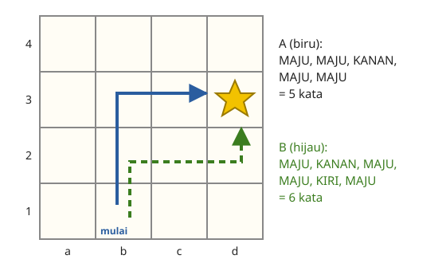

**Ingat dulu:** Tanpa melihat catatan, tulis satu ciri algoritma yang baik.

**Contoh:** Mesin mulai di b1 menghadap atas. Bintang di d3.

Algoritma A: MAJU, MAJU, KANAN, MAJU, MAJU. Algoritma B: MAJU, KANAN, MAJU, MAJU, KIRI, MAJU.

`[Gambar: kisi 4x4, kolom a sampai d, baris 1 sampai 4. Garis biru dari b1 naik ke b3, ke kanan ke d3: lima kata. Garis hijau putus-putus dari b1 ke b2, ke kanan ke d2, naik ke d3: enam kata. Bintang di d3.]`

A memakai 5 kata. B memakai 6 kata. Keduanya sampai di d3. Pilih A.

**Bandingkan:**

| | A | B |
| --- | --- | --- |
| Sampai di d3? | ya | ya |
| Jumlah kata | 5 | ______ |

Apa yang sama? ______

Apa yang beda? ______

**Coba:** Bintang di c3, mulai b1.

A: MAJU, MAJU, KANAN, MAJU. Jumlah kata: ______

B: MAJU, KANAN, MAJU, KIRI, MAJU. Jumlah kata: ______

Yang lebih singkat: ______

Sekarang sendiri: bintang di d2, mulai b1.

A: KANAN, MAJU, MAJU, KIRI, MAJU. Jumlah kata: ______

B: MAJU, KANAN, MAJU, MAJU. Jumlah kata: ______

Keduanya sampai di d2? ______ Pilih: ______

**Ceritakan** ke temanmu mengapa kita memeriksa hasilnya sebelum menghitung kata.

**Catatan cetak (untuk guru, tidak dicetak):** satu lembar per murid, kertas A4. Lembar tidak memuat kolom nama, kelompok, tanggal, atau nilai; penandaan kertas diurus guru di sekolah.
