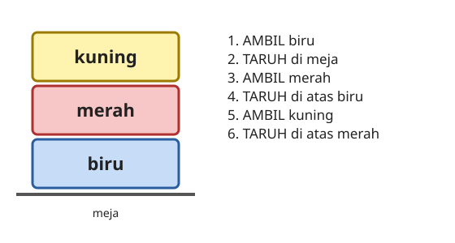

**Ingat dulu:** Tanpa melihat catatan, tulis mengapa kita memeriksa hasilnya sebelum menghitung kata.

**Contoh:** Menara: dasar biru, tengah merah, atas kuning.

`[Gambar: menara tiga kartu bertumpuk di atas meja: biru di dasar, merah di tengah, kuning di atas. Di kanan, enam baris: AMBIL biru; TARUH di meja; AMBIL merah; TARUH di atas biru; AMBIL kuning; TARUH di atas merah.]`

**Bandingkan:**

| | Instruksi A | Instruksi B |
| --- | --- | --- |
| Baris 3 | AMBIL merah | AMBIL kuning |
| Baris 5 | AMBIL kuning | AMBIL merah |
| Menara dari bawah | biru, merah, kuning | ______ |

Apa yang sama? ______

Apa yang beda? ______

**Coba:** Menara dua kartu: dasar merah, atas hijau.

1. AMBIL merah
2. TARUH di meja
3. AMBIL hijau
4. TARUH di atas ______

Sekarang sendiri: dasar kuning, tengah hijau, atas merah. Tulis enam baris.

1. ______
2. ______
3. ______
4. ______
5. ______
6. ______

Bacakan ke temanmu. Temanmu menjadi robot. Menaranya sama dengan gambar? ______

**Ceritakan** ke temanmu mengapa robot tidak boleh menebak.

**Catatan cetak (untuk guru, tidak dicetak):** satu lembar per murid, kertas A4. Lembar tidak memuat kolom nama, kelompok, tanggal, atau nilai; penandaan kertas diurus guru di sekolah.
