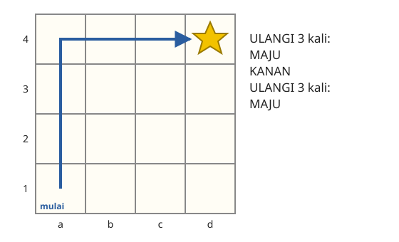

**Ingat dulu:** Tanpa melihat catatan, tulis apa beda "ulangi tiga kali" dan "ulangi sampai bintang".

**Contoh:** Mesin mulai di a1 menghadap atas. Bintang di d4.

ULANGI 3 kali: MAJU

KANAN

ULANGI 3 kali: MAJU

`[Gambar: kisi 4x4, kolom a sampai d, baris 1 sampai 4. Garis naik dari a1 ke a4, belok kanan, lalu maju ke b4, c4, dan d4, tempat bintang. Di samping tertulis algoritma ULANGI 3 kali: MAJU, KANAN, ULANGI 3 kali: MAJU.]`

**Bandingkan:**

| | Cara A | Cara B |
| --- | --- | --- |
| Isi | MAJU, MAJU, MAJU, KANAN, MAJU, MAJU, MAJU | ULANGI 3 kali: MAJU; KANAN; ULANGI 3 kali: MAJU |
| Berakhir di | d4 | ______ |

Apa yang sama? ______

Apa yang beda? ______

**Coba:** Mulai a1, bintang di c3.

ULANGI ____ kali: MAJU

KANAN

ULANGI ____ kali: MAJU

Berakhir di ______ .

Sekarang sendiri: mulai d1, bintang di a3. Tulis algoritmamu:

______

Teman menjalankannya. Sampai di a3? ______

**Ceritakan** ke temanmu bagian mana pada rutemu yang diganti dengan ULANGI.

**Catatan cetak (untuk guru, tidak dicetak):** satu lembar per murid, kertas A4. Lembar tidak memuat kolom nama, kelompok, tanggal, atau nilai; penandaan kertas diurus guru di sekolah.
