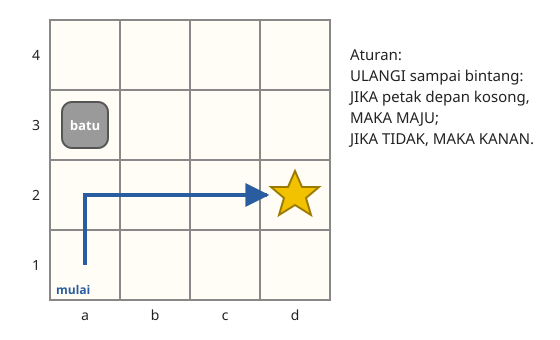

**Ingat dulu:** Tanpa melihat catatan, tulis bagian mana pada aturan jalur yang diulang dan bagian mana yang memilih.

**Contoh:** Mesin mulai di a1 menghadap atas. Papan A: batu di a3, bintang di d2.

ULANGI sampai bintang: **jika** petak depan kosong, **maka** MAJU; **jika tidak**, **maka** KANAN.

`[Gambar: kisi 4x4, kolom a sampai d, baris 1 sampai 4. Mesin mulai di a1. Batu di a3, bintang di d2. Garis naik dari a1 ke a2, belok kanan karena depan ada batu, lalu maju ke b2, c2, dan d2. Di samping tertulis aturan jalur.]`

Mesin memakai KANAN satu kali. Berakhir di d2.

**Bandingkan:**

| | Papan A | Papan B |
| --- | --- | --- |
| Batu di | a3 | a2 |
| Bintang di | d2 | d2 |
| Mesin sampai d2? | ya | ______ |

Apa yang sama? ______

Apa yang beda? ______

**Coba:** Papan C: batu di a4, bintang di d3. Aturan yang sama.

Berapa kali KANAN? ______ Berakhir di ______ .

Sekarang sendiri: gambar papanmu di kisi kecil. Mulai di a1. Taruh satu batu dan satu bintang.

Tulis aturanmu:

______

Tukar dengan temanmu. Mesin sampai bintang? ______

**Ceritakan** ke temanmu satu hal yang kamu ubah setelah diuji.

**Catatan cetak (untuk guru, tidak dicetak):** satu lembar per murid, kertas A4, dengan kisi kosong di sisi belakang. Lembar tidak memuat kolom nama, kelompok, tanggal, atau nilai; penandaan kertas diurus guru di sekolah.
