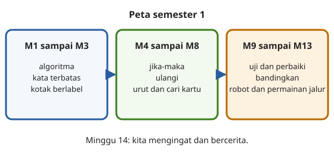

**Ingat dulu:** Tanpa melihat catatan, tulis satu hal dari tiap kelompok: urutan dan kata, jalur dan aturan, kartu dan robot.

**Contoh:** Latihan bentuk soal dengan jawaban lengkap. Mesin mulai di b1 menghadap atas. Program: MAJU, KANAN, MAJU.

`[Gambar: tiga kotak berurutan. Minggu 1 sampai 3: algoritma, kata terbatas, kotak berlabel. Minggu 4 sampai 8: jika-maka, ulangi, urut dan cari kartu. Minggu 9 sampai 13: uji dan perbaiki, bandingkan, robot dan permainan jalur.]`

Jawaban: c2, karena MAJU ke b2, KANAN menghadap kanan, MAJU ke c2.

**Bandingkan:**

- Jawaban A: "c2."
- Jawaban B: "c2, karena MAJU ke b2, KANAN menghadap kanan, MAJU ke c2."

Apa yang sama? Apa yang beda? Mana yang memuat alasan? ______

**Coba:** Mulai b1, menghadap atas. Program: MAJU, KANAN, MAJU, MAJU.

Berakhir di ______ , karena ______ .

Sekarang sendiri: tulis tiga langkah cara mengurutkan enam kartu bilangan.

1. ______
2. ______
3. ______

**Refleksi:** Tulis atau gambar satu hal yang paling kamu sukai dan satu hal yang mau kamu latih lagi.

______

**Ceritakan** ke temanmu satu hal yang kamu pelajari semester ini.

**Catatan cetak (untuk guru, tidak dicetak):** satu lembar per murid, kertas A4. Lembar ini latihan bentuk soal, bukan lembar kerja penilaian; guru menyusun lembar kerjanya sendiri. Lembar tidak memuat kolom nama, kelompok, tanggal, atau nilai; penandaan kertas diurus guru di sekolah.
