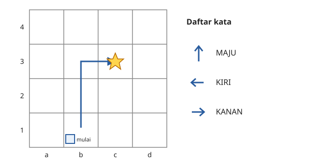

**Ingat dulu:** Tanpa melihat catatan, tulis satu langkah resep roti isi.

**Contoh:** Mesin mulai di b1 menghadap atas. MAJU: maju satu petak. KANAN dan KIRI: putar di tempat.

`[Gambar: kisi 4x4, kolom a sampai d, baris 1 sampai 4. Panah dari b1 naik ke b3, belok kanan ke c3, tempat bintang. Di samping ada daftar kata: MAJU, KIRI, KANAN.]`

Program: MAJU, MAJU, KANAN, MAJU. Berakhir di c3.

**Bandingkan:**

| | Program A | Program B |
| --- | --- | --- |
| Kata | MAJU, MAJU, KANAN, MAJU | MAJU, MAJU, KIRI, MAJU |
| Berakhir di | c3 | ______ |

Apa yang sama? ______

Apa yang beda? ______

**Coba:** Tujuan d3 dari b1. MAJU, MAJU, ______, MAJU, MAJU

Sekarang sendiri: tujuan a4 dari b1. Tulis programmu memakai MAJU, KIRI, KANAN.

______

Tukar dengan temanmu. Berakhir di a4? ______

**Ceritakan** ke temanmu mengapa kata untuk mesin dibatasi.

**Catatan cetak (untuk guru, tidak dicetak):** satu lembar per murid, kertas A4. Lembar tidak memuat kolom nama, kelompok, tanggal, atau nilai; penandaan kertas diurus guru di sekolah.
