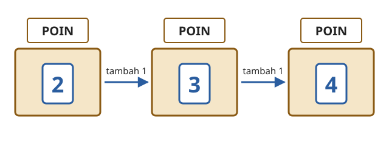

**Ingat dulu:** Tanpa melihat catatan, tulis satu kata yang dipakai mesin di kisi.

**Contoh:** Kotak berlabel POIN berisi kartu 2. Kamu menambah satu. Kartu lama dikeluarkan, kartu baru dimasukkan. Isinya menjadi 3, lalu 4. Labelnya tetap POIN.

`[Gambar: tiga kotak berderet dengan label POIN. Kotak pertama berisi kartu 2, kotak kedua kartu 3, kotak ketiga kartu 4. Di antara kotak ada panah dengan tulisan tambah 1.]`

**Bandingkan:**

| | Kotak A | Kotak B |
| --- | --- | --- |
| Label | POIN | LANGKAH |
| Isi | 3 | 3 |

Apa yang sama? ______

Apa yang beda? ______

**Coba:** Kotak POIN berisi 4. Tambah 2. Sekarang berisi ______.

Ganti menjadi 1. Sekarang berisi ______.

Sekarang sendiri: kotak LANGKAH berisi 0. Kamu melangkah tiga kali. Tiap langkah tambah satu. Tulis isi kotak setelah tiap langkah:

______ , ______ , ______

Lalu kembali ke awal. Isi LANGKAH diganti menjadi ______.

**Ceritakan** ke temanmu apa yang tetap dan apa yang berubah pada kotak berlabel.

**Catatan cetak (untuk guru, tidak dicetak):** satu lembar per murid, kertas A4. Lembar tidak memuat kolom nama, kelompok, tanggal, atau nilai; penandaan kertas diurus guru di sekolah.
