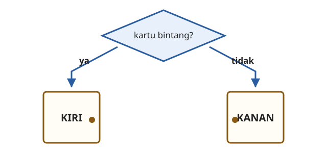

**Ingat dulu:** Tanpa melihat catatan, tulis satu hal yang tetap pada kotak berlabel.

**Contoh:** Aturan: **jika** kartumu bintang, **maka** lewat pintu KIRI. **Jika tidak**, **maka** lewat pintu KANAN. Kartu bintang lewat pintu KIRI.

`[Gambar: kotak aturan di atas bertulis kartu bintang? Dua panah turun. Panah kiri bertulis ya menuju pintu KIRI. Panah kanan bertulis tidak menuju pintu KANAN.]`

**Bandingkan:**

| | Kartu bintang | Kartu bulat |
| --- | --- | --- |
| Lewat pintu | KIRI | ______ |

Apa yang sama? ______

Apa yang beda? ______

**Coba:** Aturan baru: jika kartu merah, maka pintu KANAN; jika tidak, maka pintu KIRI.

Kartu biru lewat pintu ______.

Kartu merah lewat pintu ______.

Sekarang sendiri: tulis aturanmu tentang hujan.

Jika ______, maka ______.

Jika tidak, maka ______.

Tukar dengan temanmu. Coba dua keadaan: hujan dan tidak hujan. Aturannya jalan? ______

**Ceritakan** ke temanmu mengapa hanya satu pintu yang dilewati.

**Catatan cetak (untuk guru, tidak dicetak):** satu lembar per murid, kertas A4. Lembar tidak memuat kolom nama, kelompok, tanggal, atau nilai; penandaan kertas diurus guru di sekolah.
