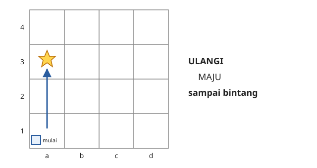

**Ingat dulu:** Tanpa melihat catatan, tulis satu aturan jika-maka-jika tidak.

**Contoh:** Mesin mulai di a1 menghadap atas. Bintang di a3. ULANGI MAJU sampai bintang.

`[Gambar: kisi 4x4, kolom a sampai d, baris 1 sampai 4. Panah dari a1 naik ke a2 dan berhenti di a3, tempat bintang. Di samping tertulis: ULANGI MAJU sampai bintang.]`

Mesin berakhir di a3.

**Bandingkan:** Kisi A: bintang di a3. Kisi B: bintang di a4. Mesin mulai di a1 menghadap atas.

| Aturan | Berakhir di, kisi A | Berakhir di, kisi B |
| --- | --- | --- |
| ULANGI tiga kali MAJU | a4 | a4 |
| ULANGI MAJU sampai bintang | ______ | ______ |

Apa yang sama? ______

Apa yang beda? ______

**Coba:** Mesin di a1 menghadap kanan. Tembok berarti tepi kisi.

ULANGI MAJU sampai ______. Mesin berakhir di d1.

Sekarang sendiri: mesin di a1 menghadap atas, bintang di a3. Tujuan d3.

Tulis programmu dengan ULANGI sampai bintang, KANAN, dan ULANGI sampai tembok.

______

Tukar dengan temanmu. Berakhir di d3? ______

**Ceritakan** ke temanmu beda "ulangi tiga kali" dan "ulangi sampai".

**Catatan cetak (untuk guru, tidak dicetak):** satu lembar per murid, kertas A4. Lembar tidak memuat kolom nama, kelompok, tanggal, atau nilai; penandaan kertas diurus guru di sekolah.
