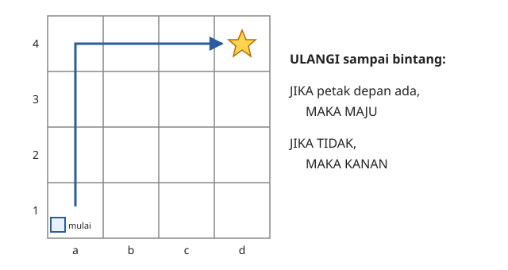

**Ingat dulu:** Tanpa melihat catatan, tulis apa arti "ULANGI sampai bintang".

**Contoh:** Mesin mulai di a1 menghadap atas. Bintang di d4. Algoritma A:

ULANGI sampai bintang: **jika** petak depan masih di dalam kisi, **maka** MAJU; **jika tidak**, **maka** KANAN.

`[Gambar: kisi 4x4, kolom a sampai d, baris 1 sampai 4. Panah dari a1 naik ke a4, belok kanan di a4, lalu maju ke b4, c4, dan d4, tempat bintang. Di samping tertulis algoritma A.]`

Mesin memakai KANAN satu kali. Berakhir di d4.

**Bandingkan:**

| | Algoritma A | Algoritma B |
| --- | --- | --- |
| Isi | ULANGI sampai bintang, dengan jika-maka-jika tidak | ULANGI MAJU sampai bintang |
| Bintang di d4, berakhir di | d4 | ______ |

Apa yang sama? ______

Apa yang beda? ______

**Coba:** Bintang di d3. Algoritma A dipakai.

Berapa kali KANAN? ______

Berakhir di ______.

Sekarang sendiri: bintang di c1.

Berapa kali KANAN? ______

Petak mana yang dilewati tepat sebelum c1? ______

**Ceritakan** ke temanmu bagian mana yang diulang dan bagian mana yang memilih.

**Catatan cetak (untuk guru, tidak dicetak):** satu lembar per murid, kertas A4. Lembar tidak memuat kolom nama, kelompok, tanggal, atau nilai; penandaan kertas diurus guru di sekolah.
