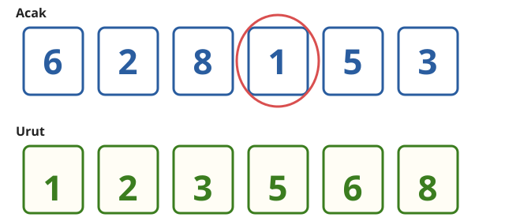

**Ingat dulu:** Tanpa melihat catatan, tulis satu bagian yang diulang pada algoritma jalur.

**Contoh:** Enam kartu: 6, 2, 8, 1, 5, 3. Cara: (1) cari kartu terkecil; (2) taruh di sebelah kanan barisan yang sudah urut; (3) ulangi sampai semua kartu terpakai. Hasilnya 1, 2, 3, 5, 6, 8.

`[Gambar: dua baris kartu. Baris atas, acak: 6, 2, 8, 1, 5, 3, dengan kartu 1 dilingkari. Baris bawah, urut dari kecil ke besar: 1, 2, 3, 5, 6, 8.]`

**Bandingkan:**

| | Barisan A | Barisan B |
| --- | --- | --- |
| Cara | cari **terkecil** | cari **terbesar** |
| Hasil | 1, 2, 3, 5, 6, 8 | ______ |

Apa yang sama? ______

Apa yang beda? ______

**Coba:** Kartu 9, 4, 7, 2, 8, 5.

Terkecil: 2. Terkecil berikutnya: ______ . Lalu: ______ , ______ , ______ , ______

Sekarang sendiri: kartu 3, 10, 6, 1, 8, 4.

Hasil urut: ______

Tulis caramu dengan kata sendiri:

______

Tukar dengan temanmu. Hasilnya sama? ______

**Ceritakan** ke temanmu langkah mana yang diulang saat mengurutkan.

**Catatan cetak (untuk guru, tidak dicetak):** satu lembar per murid, kertas A4. Lembar tidak memuat kolom nama, kelompok, tanggal, atau nilai; penandaan kertas diurus guru di sekolah.
