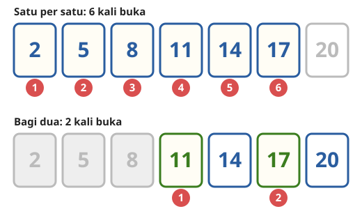

**Ingat dulu:** Tanpa melihat catatan, tulis mengapa kartu yang sudah terurut membuat mencari lebih mudah.

**Contoh:** Kartu terurut: 2, 5, 8, 11, 14, 17, 20. Cari 17.

`[Gambar: dua baris kartu 2, 5, 8, 11, 14, 17, 20. Baris atas: kartu dibuka dari kiri satu per satu, enam kali buka, nomor 1 sampai 6. Baris bawah: kartu tengah 11 dibuka lebih dulu, tiga kartu di kirinya dikelabukan, lalu kartu 17 dibuka; dua kali buka.]`

Satu per satu: 6 kali buka. Bagi dua: 2 kali buka.

**Bandingkan:**

| | Satu per satu | Bagi dua |
| --- | --- | --- |
| Cara | buka dari kiri | buka kartu **tengah** dulu |
| Cari 17, jumlah buka | 6 | 2 |

Apa yang sama? ______

Apa yang beda? ______

**Coba:** Kartu 3, 6, 9, 12, 15, 18, 21. Cari 6.

Satu per satu: ______ kali buka.

Bagi dua: buka ______ dulu, lalu ______ . Jumlah buka: ______

Sekarang sendiri: kartu 4, 7, 10, 13, 16, 19, 22. Cari 16.

Satu per satu: ______ kali buka.

Bagi dua: ______ kali buka.

Cara mana yang lebih singkat? ______

**Ceritakan** ke temanmu mengapa cara bagi dua perlu kartu yang terurut.

**Catatan cetak (untuk guru, tidak dicetak):** satu lembar per murid, kertas A4. Lembar tidak memuat kolom nama, kelompok, tanggal, atau nilai; penandaan kertas diurus guru di sekolah.
