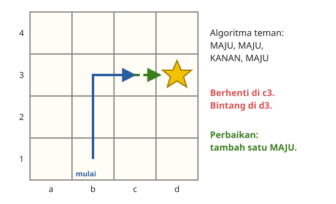

**Ingat dulu:** Tanpa melihat catatan, tulis satu cara mencari kartu tersembunyi.

**Contoh:** Mesin mulai di b1 menghadap atas. Bintang di d3. Algoritma teman: MAJU, MAJU, KANAN, MAJU.

`[Gambar: kisi 4x4, kolom a sampai d, baris 1 sampai 4. Garis naik dari b1 ke b3, belok kanan ke c3 dan berhenti. Bintang di d3. Garis putus-putus dari c3 ke d3 menunjukkan perbaikan: satu MAJU lagi.]`

Mesin berhenti di c3, bukan d3. Perbaikan: tambah satu MAJU.

**Bandingkan:**

| | Teman A | Teman B |
| --- | --- | --- |
| Algoritma | MAJU, MAJU, KANAN, MAJU | MAJU, MAJU, KIRI, MAJU, MAJU |
| Hasil | berhenti di c3 | lewat a3, lalu ______ |

Apa yang sama? ______

Apa yang beda? ______

**Coba:** Mulai b1, bintang d2. Teman: MAJU, KANAN, MAJU, MAJU, MAJU.

Mesin berhenti karena ______ .

Perbaikan: ______

Sekarang sendiri: mulai b1, bintang c4. Teman: MAJU, MAJU, KANAN, MAJU, KANAN, MAJU.

Mesin berakhir di ______ .

Kata mana yang kamu ganti? ______

Berakhir di ______ setelah diperbaiki.

**Ceritakan** ke temanmu bagaimana kamu menemukan langkah yang salah.

**Catatan cetak (untuk guru, tidak dicetak):** satu lembar per murid, kertas A4. Lembar tidak memuat kolom nama, kelompok, tanggal, atau nilai; penandaan kertas diurus guru di sekolah.
