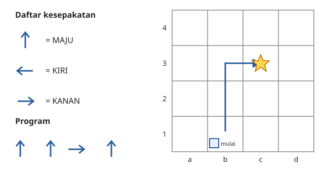

**Ingat dulu:** Tanpa melihat catatan, tulis satu kata yang boleh dipakai mesin di kisi.

**Contoh:** Mesin mulai di b1 menghadap atas. Daftar kita: panah atas = MAJU, panah kiri = KIRI, panah kanan = KANAN.

`[Gambar: daftar tiga simbol: panah atas = MAJU, panah kiri = KIRI, panah kanan = KANAN. Di bawahnya program empat simbol: atas, atas, kanan, atas. Di kanan kisi 4x4: jalur dari b1 naik ke b3, belok kanan, lalu ke c3, tempat bintang.]`

Program: atas, atas, kanan, atas. Berakhir di c3.

**Bandingkan:** simbol sama, daftar beda.

| | Daftar A | Daftar B |
| --- | --- | --- |
| Panah kanan berarti | KANAN | KIRI |
| Berakhir di | c3 | ______ |

Apa yang sama? ______

Apa yang beda? ______

**Coba:** Tujuan d3 dari b1. atas, atas, ______, atas, atas

Baca program ini dari b1: atas, kanan, atas, atas. Berakhir di ______

Sekarang sendiri: tujuan a4 dari b1. Tulis programmu dengan simbol.

______

Tukar dengan temanmu. Berakhir di a4? ______

**Ceritakan** ke temanmu mengapa daftar kesepakatan harus ada.

**Catatan cetak (untuk guru, tidak dicetak):** satu lembar per murid, kertas A4. Lembar tidak memuat kolom nama, kelompok, tanggal, atau nilai; penandaan kertas diurus guru di sekolah.
