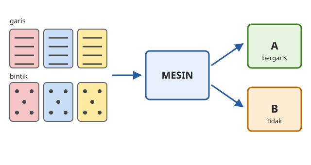

# Mesin mengenali pola

**Ingat dulu:** Tanpa melihat catatan, tulis dua keadaan sebuah kartu dua sisi.

**Contoh:** Aturan 1: AMBIL satu kartu. JIKA bergaris, MAKA TARUH di kotak A. JIKA TIDAK, MAKA TARUH di kotak B. Hasil: A berisi tiga kartu garis, B berisi tiga kartu bintik.

`[Gambar: di kiri enam kartu pola: tiga bergaris (merah, biru, kuning) dan tiga berbintik (merah, biru, kuning). Panah menuju kardus bertulis MESIN, lalu dua kotak: A untuk kartu garis dan B untuk kartu bintik.]`

**Bandingkan:** Aturan 2: JIKA merah, MAKA TARUH di kotak A. JIKA TIDAK, MAKA TARUH di kotak B.

Kartu yang sama. Kotak A berisi: ______

Apa yang sama? ______ Apa yang beda? ______

**Coba:** Aturan 3: JIKA bintik, MAKA A. JIKA TIDAK, MAKA B.

Kartu baru bintik hijau masuk kotak ______ .

Sekarang sendiri. Aturan: JIKA biru, MAKA A. JIKA TIDAK, MAKA B.

| Kartu | Kotak |
| --- | --- |
| garis kuning | ______ |
| bintik biru | ______ |
| garis biru | ______ |
| bintik merah | ______ |
| kartu baru: bintik hijau | ______ |

**Ceritakan** ke temanmu mengapa kartu hijau masuk kotak itu.

**Catatan cetak (untuk guru, tidak dicetak):** satu lembar per murid, kertas A4. Lembar tidak memuat kolom nama, kelompok, tanggal, atau nilai; penandaan kertas diurus guru di sekolah.
