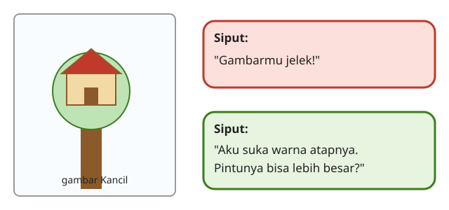

**Ingat dulu:** Tanpa melihat catatan, tulis kepada siapa kamu bertanya bila ragu membagikan pesan.

**Contoh:** Kancil membagikan gambar rumah pohon. Siput membalas: "Gambarmu jelek!" Kancil jadi sedih. Ini kata yang menyakitkan.

`[Gambar: gambar rumah pohon sederhana di kiri. Di kanan dua gelembung balasan: gelembung merah "Gambarmu jelek!" dan gelembung hijau "Aku suka warna atapnya. Pintunya bisa lebih besar?"]`

**Bandingkan:** balasan "Gambarmu jelek!" dan balasan "Aku suka warna atapnya. Pintunya bisa lebih besar?"

Apa yang sama? ______

Apa yang beda? ______

Kancil sedih atau senang saat membaca balasan kedua? ______

**Coba:** Tulis BAIK atau MENYAKITKAN.

| Balasan | Jenis |
| --- | --- |
| Aku suka warna atapnya. | ______ |
| Aku tidak mau bermain dengan kamu lagi. | ______ |
| Terima kasih sudah membagikan gambarmu. | ______ |

Sekarang sendiri. Tulis balasan baru untuk "Gambarmu jelek!" Ingat tiga pertanyaan: Bagaimana perasaan penerima? Maukah aku menerimanya? Adakah kata yang lebih baik?

______

**Ceritakan** ke temanmu satu kata yang baik.

**Catatan cetak (untuk guru, tidak dicetak):** satu lembar per murid, kertas A4. Lembar tidak memuat kolom nama, kelompok, tanggal, atau nilai; penandaan kertas diurus guru di sekolah.
