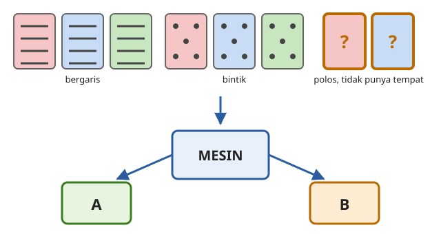

# Penguatan: mesin kotak

**Ingat dulu:** Tanpa melihat catatan, tulis ke kotak mana kartu bintik pergi pada aturan JIKA bergaris, MAKA A, JIKA TIDAK, MAKA B.

**Contoh:** Aturan 1: JIKA bergaris, MAKA TARUH di kotak A. JIKA TIDAK, MAKA TARUH di kotak B. Semua kartu punya tempat.

`[Gambar: delapan kartu pola di atas: tiga bergaris, tiga berbintik, dua polos. Di bawahnya kardus MESIN dengan dua kotak, A dan B. Dua kartu polos diberi tanda tanya karena tidak punya tempat pada Aturan 2.]`

**Bandingkan:** Aturan 2: JIKA bergaris, MAKA A. JIKA bintik, MAKA B.

Kartu mana yang tidak punya tempat? ______

Apa yang sama dengan Aturan 1? ______ Apa yang beda? ______

**Coba:** Perbaiki Aturan 2 supaya semua kartu punya tempat.

JIKA bergaris, MAKA A. JIKA bintik, MAKA B. Tambah: ______

Sekarang sendiri. Aturan: JIKA merah, MAKA A. JIKA biru, MAKA B.

| Kartu | Kotak |
| --- | --- |
| garis merah | ______ |
| bintik hijau | ______ |
| polos biru | ______ |
| garis hijau | ______ |

Tulis TIDAK ADA TEMPAT bila kartu tidak punya tempat. Apa yang kamu tambah pada aturan?

______

**Ceritakan** ke temanmu mengapa semua kartu perlu punya tempat.

**Catatan cetak (untuk guru, tidak dicetak):** satu lembar per murid, kertas A4. Lembar tidak memuat kolom nama, kelompok, tanggal, atau nilai; penandaan kertas diurus guru di sekolah.
