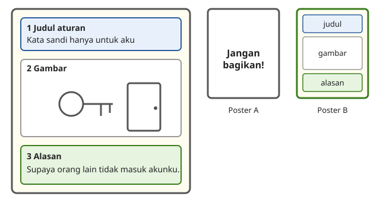

**Ingat dulu:** Tanpa melihat catatan, tulis satu aturan aman di dunia digital dan alasannya.

**Contoh:** Poster guru. Judul: Kata sandi hanya untuk aku dan orang tuaku. Gambar: kunci dan pintu. Alasan: Supaya orang lain tidak bisa masuk ke akunku.

`[Gambar: poster besar dengan tiga bagian bernomor: 1 judul aturan di atas, 2 gambar kunci dan pintu di tengah, 3 alasan di bawah. Di samping, poster kecil A hanya bertulis "Jangan bagikan!" dan poster kecil B memuat judul, gambar, dan alasan.]`

**Bandingkan:** poster A "Jangan bagikan!" dan poster B.

Apa yang sama? ______ Apa yang beda? ______

**Coba:** Aturan 2: Tanya orang dewasa dulu sebelum membagikan.

Alasan: Orang dewasa ______ kita menilai apakah aman.

Sekarang kelompokmu. Pilih satu aturan dari papan.

Nomor aturan: ______

Judul posterku: ______

Alasanku: ______

Gambarku: ______

**Periksa** bersama pemeriksa kelompok:

- Posternya terbaca? ______
- Ada alasan? ______
- Tidak ada nama, alamat, nomor, atau kata sandi? ______

**Ceritakan** ke temanmu satu hal yang kamu ubah setelah diperiksa.

**Catatan cetak (untuk guru, tidak dicetak):** satu lembar per murid atau per kelompok, kertas A4. Lembar tidak memuat kolom nama, kelompok, tanggal, atau nilai; penandaan kertas diurus guru di sekolah.
