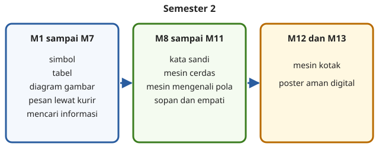

# Asesmen dan refleksi

**Ingat dulu:** Tanpa melihat catatan, tulis satu hal dari tiap kelompok: simbol dan pesan, tabel dan diagram, aman digital, mesin dan kotak.

**Contoh:** Latihan bentuk soal dengan jawaban lengkap. Mulai di b1, menghadap atas. Panah atas = MAJU, panah kanan = KANAN. Program simbol: atas, kanan, atas.

`[Gambar: tiga kotak berurutan. Minggu 1 sampai 7: simbol, tabel, diagram, pesan, mencari informasi. Minggu 8 sampai 11: kata sandi, mesin cerdas, pola, sopan. Minggu 12 dan 13: mesin kotak dan poster.]`

Jawaban: c2, karena atas maju ke b2, kanan menghadap kanan, atas maju ke c2.

**Bandingkan:**

- Jawaban A: "c2."
- Jawaban B: "c2, karena atas maju ke b2, kanan menghadap kanan, atas maju ke c2."

Apa yang sama? Apa yang beda? Mana yang memuat alasan? ______

**Coba:** Mulai b1, menghadap atas. Program simbol: atas, atas, kanan, atas, atas.

Berakhir di ______ , karena ______ .

Sekarang sendiri:

1. Tabel buah: apel 2, jeruk 5, pisang 3. Paling banyak: ______ . Kotak diagram untuk pisang: ______ .
2. Tulis BOLEH atau TANYA: "Aku suka menggambar kucing." ______ "Besok aku sendirian di rumah." ______
3. Dua ciri mesin cerdas: ______ dan ______ .

**Refleksi:** Tulis atau gambar satu hal yang paling kamu sukai dan satu hal yang mau kamu latih lagi.

______

**Ceritakan** ke temanmu satu hal yang kamu pelajari semester ini.

**Catatan cetak (untuk guru, tidak dicetak):** satu lembar per murid, kertas A4. Latihan bentuk soal, bukan lembar kerja penilaian; guru menyusun lembar kerjanya sendiri. Lembar tidak memuat kolom nama, kelompok, tanggal, atau nilai; penandaan kertas diurus guru di sekolah.
