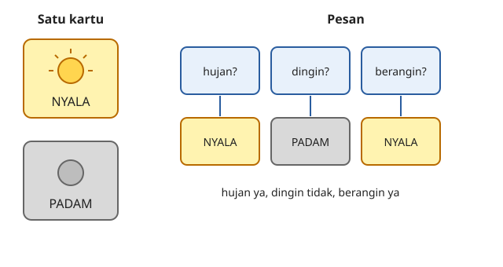

**Ingat dulu:** Tanpa melihat catatan, tulis arti satu simbol dari daftar kesepakatan minggu lalu.

**Contoh:** NYALA berarti ya. PADAM berarti tidak. Tiga pertanyaan: hujan? dingin? berangin?

`[Gambar: di kiri satu kartu dua sisi: sisi kuning bergambar lampu menyala bertulis NYALA, sisi abu-abu bergambar lampu mati bertulis PADAM. Di kanan tiga kartu pertanyaan (hujan?, dingin?, berangin?) dan di bawahnya tiga kartu jawaban: NYALA, PADAM, NYALA.]`

Pesan: NYALA, PADAM, NYALA. Artinya hujan ya, dingin tidak, berangin ya.

**Bandingkan:**

| | Pesan P | Pesan Q |
| --- | --- | --- |
| Kartu | NYALA, PADAM, NYALA | PADAM, NYALA, NYALA |
| Hujan? | ya | ______ |
| Dingin? | tidak | ______ |
| Berangin? | ya | ______ |

Apa yang sama? ______

Apa yang beda? ______

**Coba:** Hujan ya, dingin ya, berangin tidak. NYALA, ______, ______

Sekarang sendiri: hujan tidak, dingin ya, berangin tidak. Tulis kartunya.

______

Tunjukkan ke temanmu. Temanmu membaca artinya dengan benar? ______

Tantangan: dua kartu dua sisi. Ada berapa pesan yang berbeda? ______

**Ceritakan** ke temanmu mengapa letak kartu harus disepakati.

**Catatan cetak (untuk guru, tidak dicetak):** satu lembar per murid, kertas A4. Lembar tidak memuat kolom nama, kelompok, tanggal, atau nilai; penandaan kertas diurus guru di sekolah.
