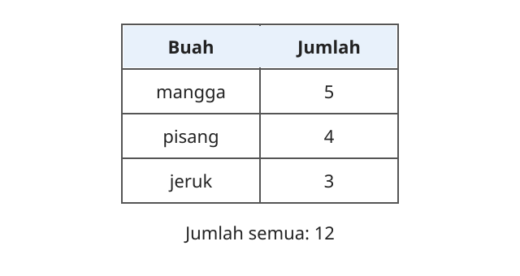

# Data: tabel sederhana

**Ingat dulu:** Tanpa melihat catatan, tulis satu hal yang membuat data mudah dicari.

**Contoh:** Dua belas kartu buah: mangga, pisang, mangga, jeruk, pisang, mangga, mangga, pisang, jeruk, mangga, pisang, jeruk.

`[Gambar: tabel dua kolom, Buah dan Jumlah. Baris mangga 5, pisang 4, jeruk 3. Di bawahnya jumlah semua: 12.]`

**Bandingkan:** kartu acak dan tabel. Buah apa yang paling banyak? ______

Apa yang sama? ______

Apa yang beda? ______

**Coba:** Sembilan kartu: apel, jeruk, apel, pisang, jeruk, jeruk, apel, jeruk, pisang.

| Buah | Jumlah |
| --- | --- |
| apel | 3 |
| jeruk | ______ |
| pisang | 2 |

Jumlah semua: ______

Sekarang sendiri. Delapan kartu: mangga, pisang, pisang, mangga, jeruk, pisang, pisang, mangga.

| Buah | Jumlah |
| --- | --- |
| ______ | ______ |
| ______ | ______ |
| ______ | ______ |

Jumlah semua: ______ Sama dengan banyak kartu? ______

**Ceritakan** ke temanmu mengapa tabel membantu mencari yang paling banyak.

**Catatan cetak (untuk guru, tidak dicetak):** satu lembar per murid, kertas A4. Lembar tidak memuat kolom nama, kelompok, tanggal, atau nilai; penandaan kertas diurus guru di sekolah.
