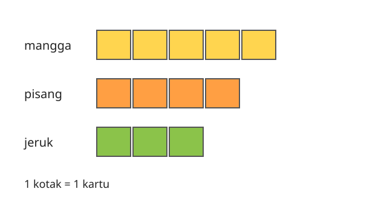

**Ingat dulu:** Tanpa melihat catatan, tulis apa yang kamu cek setelah menghitung semua baris tabel.

**Contoh:** Tabel buah: mangga 5, pisang 4, jeruk 3. Satu kotak = satu kartu.

`[Gambar: tiga baris. Baris mangga punya 5 kotak kuning, baris pisang 4 kotak oranye, baris jeruk 3 kotak hijau. Semua kotak sama besar dan berderet dari kiri. Di bawah tertulis: 1 kotak = 1 kartu.]`

**Bandingkan:** tabel dan diagram gambar.

Apa yang sama? ______

Apa yang beda? ______

**Coba:** Tabel: apel 3, jeruk 4, pisang 2. Baris apel sudah ada. Gambar baris jeruk dan pisang.

| Buah | Kotak |
| --- | --- |
| apel | ■ ■ ■ |
| jeruk | |
| pisang | |

Jumlah semua kotak: ______

Sekarang sendiri. Tabel: mangga 3, pisang 4, jeruk 1. Gambar diagramnya di kertas kotak-kotak.

Jumlah semua kotak: ______ Buah yang paling banyak: ______

**Ceritakan** ke temanmu mengapa semua kotak harus sama besar.

**Catatan cetak (untuk guru, tidak dicetak):** satu lembar per murid, kertas A4 dengan kertas kotak-kotak tambahan. Lembar tidak memuat kolom nama, kelompok, tanggal, atau nilai; penandaan kertas diurus guru di sekolah.
