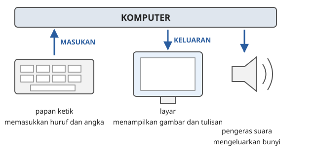

# Perangkat dan fungsinya

**Ingat dulu:** Tanpa melihat catatan, tulis satu contoh masukan dan satu contoh keluaran.

**Contoh:** Papan ketik: memasukkan huruf dan angka. Ia masuk kotak MASUKAN.

`[Gambar: kotak KOMPUTER di atas. Papan ketik ("memasukkan huruf dan angka") punya panah ke atas menuju komputer, bertanda MASUKAN. Layar ("menampilkan gambar dan tulisan") dan pengeras suara ("mengeluarkan bunyi") punya panah dari komputer ke bawah; panah layar bertanda KELUARAN.]`

**Bandingkan:** papan ketik dan layar.

Apa yang sama? ______

Apa yang beda? ______

**Coba:** Cocokkan dengan garis.

| Perangkat | Fungsi |
| --- | --- |
| tetikus | mengeluarkan bunyi |
| pengeras suara | menunjuk dan memilih |

Tulis yang benar: tetikus: ______ pengeras suara: ______

Sekarang sendiri. Tulis fungsi dan kotaknya (MASUKAN atau KELUARAN).

| Perangkat | Fungsi | Kotak |
| --- | --- | --- |
| mikrofon | ______ | ______ |
| pencetak | ______ | ______ |

Pilihan fungsi: memasukkan bunyi; mencetak tulisan di kertas.

**Ceritakan** ke temanmu satu perangkat, fungsinya, dan kotaknya.

**Catatan cetak (untuk guru, tidak dicetak):** satu lembar per murid, kertas A4. Lembar tidak memuat kolom nama, kelompok, tanggal, atau nilai; penandaan kertas diurus guru di sekolah.
