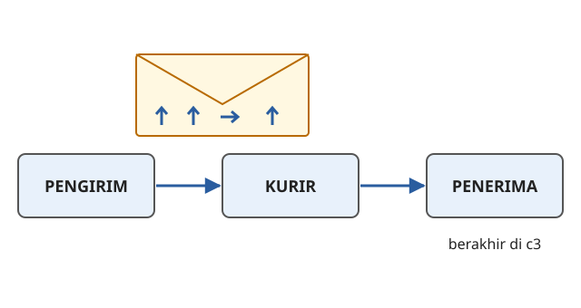

**Ingat dulu:** Tanpa melihat catatan, tulis satu perangkat masukan dan satu perangkat keluaran.

**Contoh:** Pengirim menulis pesan dan memasukkannya ke amplop. Kurir membawanya tanpa mengubah. Penerima menjalankannya dari b1 menghadap atas.

`[Gambar: tiga kotak berderet dengan panah: PENGIRIM, KURIR, PENERIMA. Di atas panah ada amplop berisi empat kartu panah: atas, atas, kanan, atas. Di bawah penerima tertulis: berakhir di c3.]`

Pesan: atas, atas, kanan, atas. Berakhir di c3.

**Bandingkan:** pesan sampai utuh dan pesan yang berubah.

| | Pesan utuh | Pesan berubah |
| --- | --- | --- |
| Kartu | atas, atas, kanan, atas | atas, atas, atas, kanan |
| Berakhir di | c3 | ______ |

Apa yang sama? ______

Apa yang beda? ______

**Coba:** Pesan: atas, atas, kiri, atas. Penerima mulai di b1. Berakhir di ______

Sekarang sendiri: tulis pesan ke bintang di d2 dari b1.

______

Tulis balasan penerima: "Aku menjalankan pesanmu. Aku berakhir di ______."

**Ceritakan** ke temanmu tugas kurir dan apa yang tidak boleh ia lakukan.

**Catatan cetak (untuk guru, tidak dicetak):** satu lembar per murid, kertas A4. Lembar tidak memuat kolom nama, kelompok, tanggal, atau nilai; penandaan kertas diurus guru di sekolah.
