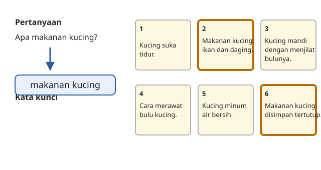

# Mencari informasi, didampingi guru

**Ingat dulu:** Tanpa melihat catatan, tulis tugas perantara pada pesan berantai.

**Contoh:** Pertanyaan: "Apa makanan kucing?" Kata kunci: makanan kucing. Mesin kertas mengangkat kartu yang memuat kedua kata: kartu 2 dan kartu 6.

`[Gambar: pertanyaan "Apa makanan kucing?" dengan panah ke kotak kata kunci "makanan kucing". Di kanan enam kartu bernomor 1 sampai 6; kartu 2 dan kartu 6 diberi bingkai tebal.]`

Kartu: (1) Kucing suka tidur. (2) Makanan kucing: ikan dan daging. (3) Kucing mandi dengan menjilat bulunya. (4) Cara merawat bulu kucing. (5) Kucing minum air bersih. (6) Makanan kucing disimpan tertutup.

**Bandingkan:**

| Kata kunci | Kartu yang diangkat |
| --- | --- |
| kucing | 1, 2, 3, 4, 5, 6 |
| makanan kucing | ______ |

Apa yang sama? ______

Apa yang beda? ______

**Coba:** Pertanyaan: "Bagaimana kucing mandi?" Kata kunci: ______ kucing. Kartu yang diangkat: ______

Sekarang sendiri. Pertanyaan: "Bagaimana merawat bulu kucing?"

Kata kunciku: ______

Kartu yang diangkat: ______ Menjawab pertanyaan? ______

**Ceritakan** ke temanmu bagaimana kamu memilih kata kunci.

**Catatan cetak (untuk guru, tidak dicetak):** satu lembar per murid, kertas A4. Lembar tidak memuat kolom nama, kelompok, tanggal, atau nilai; penandaan kertas diurus guru di sekolah.
