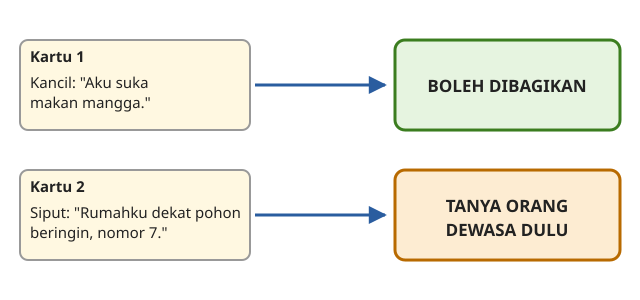

**Ingat dulu:** Tanpa melihat catatan, tulis mengapa pesan rahasia ditutup sebelum dititipkan.

**Contoh:** Kancil menulis: "Aku suka makan mangga." Pesan ini boleh dibagikan. Siput menulis: "Rumahku dekat pohon beringin, nomor 7." Pesan ini tanya orang dewasa dulu, karena memberi tahu tempat.

`[Gambar: dua kartu pesan, kartu 1 tentang mangga dan kartu 2 tentang rumah dekat pohon beringin. Di kanan dua kotak: kotak hijau BOLEH DIBAGIKAN dan kotak oranye TANYA ORANG DEWASA DULU. Panah dari kartu 1 ke kotak hijau dan dari kartu 2 ke kotak oranye.]`

**Bandingkan:** kartu 1 dan kartu 2.

Apa yang sama? ______

Apa yang beda? ______

**Coba:** Kura-kura menulis: "Kata sandi akunku adalah nama kucingku."

Kotaknya: ______ Alasan: ______

Sekarang sendiri. Tulis BOLEH atau TANYA.

| Pesan | Kotak |
| --- | --- |
| a. Aku suka warna biru. | ______ |
| b. Ini kata sandi akunku. | ______ |
| c. Aku belajar menghitung hari ini. | ______ |
| d. Nomor telepon Ibu adalah ... | ______ |

**Ceritakan** ke temanmu siapa yang boleh tahu kata sandi.

**Catatan cetak (untuk guru, tidak dicetak):** satu lembar per murid, kertas A4. Lembar tidak memuat kolom nama, kelompok, tanggal, atau nilai; penandaan kertas diurus guru di sekolah.
