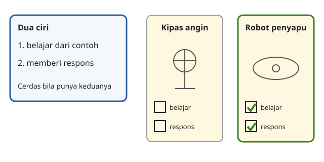

**Ingat dulu:** Tanpa melihat catatan, tulis satu alat cerdas dan satu alat biasa.

**Contoh:** Kipas angin. Belajar dari contoh? Tidak. Memberi respons tanpa ditekan tombol? Tidak. Kipas adalah mesin biasa.

`[Gambar: di kiri daftar dua ciri, belajar dari contoh dan memberi respons. Di kanan dua kartu, kipas angin dan robot penyapu, masing-masing dengan dua kotak centang. Kotak kipas kosong, kotak robot penyapu terisi tanda centang.]`

**Bandingkan:** kipas dan robot penyapu.

Apa yang sama? ______

Apa yang beda? ______

**Coba:** Pintu otomatis terbuka saat ada orang.

| Ciri | Ya atau tidak |
| --- | --- |
| Belajar dari contoh | ______ |
| Memberi respons | ______ |

Mesin cerdas? ______

Sekarang sendiri. Isi tabelnya.

| Alat | Belajar dari contoh | Memberi respons | Mesin cerdas? |
| --- | --- | --- | --- |
| Pemutar musik yang menyarankan lagu dari lagu yang sering diputar | ______ | ______ | ______ |
| Jam dinding | ______ | ______ | ______ |

**Ceritakan** ke temanmu dua ciri mesin cerdas.

**Catatan cetak (untuk guru, tidak dicetak):** satu lembar per murid, kertas A4. Lembar tidak memuat kolom nama, kelompok, tanggal, atau nilai; penandaan kertas diurus guru di sekolah.
